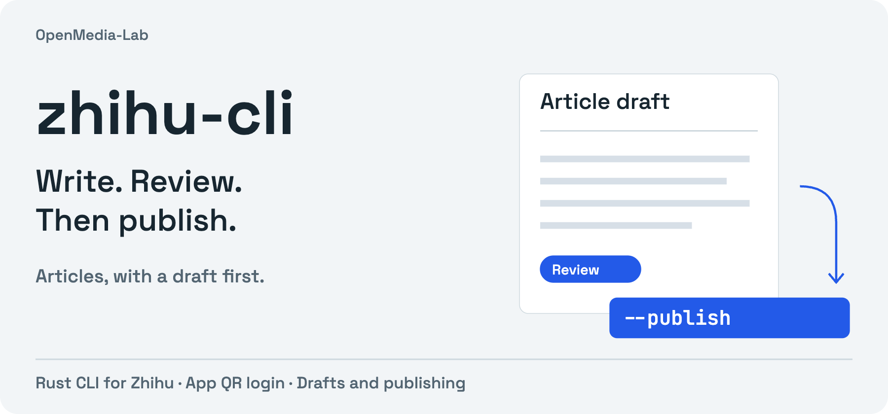

<p align="center"><strong>English</strong> · <a href="README_ZH.md">简体中文</a></p>

<p align="center"></p>

# zhihu-cli

**Read Zhihu and turn finished writing into reviewable article drafts.** A Rust CLI with app QR login, HTML bodies, images, covers and topics. The binary is `zhihu`.

[Quick start](#quick-start) · [Draft → publish](#draft-review-publish) · [Command guide](docs/usage.md) · [中文](README_ZH.md)

- **Read before writing.** Search, articles, answers, questions, pins and account history.
- **Review a real draft.** Creating an article saves a remote draft unless you explicitly pass `--publish`.
- **Revise the same article.** Update its draft, preserve omitted fields, then publish the revision.

## Quick start

Requires a current stable Rust toolchain. Install from source:

```sh
git clone https://github.com/OpenMedia-Lab/zhihu-cli.git
cd zhihu-cli
cargo install --path . --locked

zhihu login --qr
zhihu whoami
zhihu search 'Transformer'
```

Scan with the Zhihu app and confirm on your phone. `--qr-file ./zhihu-login.svg` exports a private QR image. Browser-cookie extraction and stdin import are alternatives; see [authentication](docs/usage.md#auth).

## Draft, review, publish

Put your article's HTML in `body.html`. **This saves an article draft on Zhihu:**

```sh
zhihu article 'Understanding Attention' --content-file body.html
zhihu draft ARTICLE_ID
```

Use the returned ID and `edit_url` to inspect it. Add your own cover, images or exact topic names when needed:

```sh
zhihu edit-article ARTICLE_ID --content-file revised.html
zhihu edit-article ARTICLE_ID --cover cover.png -t '深度学习'
```

**This explicitly publishes the article or its updated draft:**

```sh
zhihu edit-article ARTICLE_ID --publish
```

Omitted title, body, cover and topics are preserved. Supplied topics replace the existing list; images append when no replacement body is supplied. Published articles can have unpublished draft edits, so inspect draft content as well as the reported article state.

## Choose your workflow

| Task | Command or guide |
|---|---|
| Read an article, answer, question or pin | `zhihu read 'URL_OR_ID'` |
| Inspect your articles | `zhihu my-articles --limit 10` |
| Find exact topics | `zhihu topics 'keyword'` |
| Rehost an image | `zhihu upload image.png` |
| Draft, edit, publish or remove content | [Full command guide](docs/usage.md) |

**Pins (想法) publish immediately.** The draft-first behavior above applies to articles. Zhihu has no private-note delivery mode in this CLI. Image processing can lag; read the draft back before publishing.

## Automation and limits

Runtime errors are JSON on stderr with a nonzero exit status. Most successful commands return structured JSON; inspect the actual command output rather than assuming every operation has an identical schema. Platform sessions, web interfaces, moderation and limits still apply.

Cookies are saved at `~/.config/zhihu-cli/cookies.json`. Keep them private and out of Git. See [login verification](docs/qr-login-verification.md) for QR confirmation and session preservation. QR and pins have less live validation than the article draft path.

## Contribute

Report a minimal command, expected behavior and redacted output. For source changes:

```sh
cargo fmt --check
cargo test --no-default-features
cargo check --locked
```

## Works with

[postdeck](https://github.com/OpenMedia-Lab/postdeck) adapts articles into cards; separate CLIs handle platform operations: [xhs-cli](https://github.com/OpenMedia-Lab/xhs-cli), [zhihu-cli](https://github.com/OpenMedia-Lab/zhihu-cli), [x-cli](https://github.com/OpenMedia-Lab/x-cli). Explore the rest of [OpenMedia-Lab](https://github.com/OpenMedia-Lab).

## License

[MIT](LICENSE).
